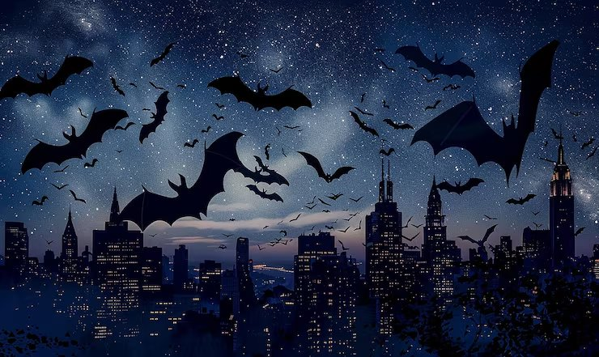

<div align="center">

<!-- CINEMATIC GOTHAM CITY HERO BACKGROUND -->


<br/><br/>

<!-- HEADER TITLE -->


<!-- BATCOMPUTER BOOT SEQUENCE TYPING SVG -->
<a href="https://github.com/dmas-zky">
  
</a>

<br/><br/>

<!-- ENCRYPTED COMMS & BAT-SIGNAL CHANNELS -->
<a href="mailto:dhimaszaky102005@gmail.com">
  
</a>
&nbsp;
<a href="https://github.com/dmas-zky?tab=repositories">
  
</a>
&nbsp;
<a href="https://instagram.com/" target="_blank">
  
</a>
&nbsp;
<a href="https://linkedin.com/" target="_blank">
  
</a>

<br/><br/>

<!-- BATMAN ASCII EMBLEM -->
<pre style="color: #f59e0b; font-family: monospace; font-size: 11px; line-height: 1.1; font-weight: bold;">
                 _==/          i     i          \==_
               /XX/            |\___/|            \XX\
             /XXXX\            |XXXXX|            /XXXX\
            |XXXXXX\_         _XXXXXXX_         _/XXXXXX|
             \XXXXXXXXXXXxxxxXXX / \ XXXxxxxXXXXXXXXXXX/
               \XXXXXXXXXXXXXXXX|< >|XXXXXXXXXXXXXXXX/
                   ""^XXXXXXXXXX|< >|XXXXXXXXXX^""
                          ""*XXXX\_/XXXX*""
</pre>

</div>

---

### 🦇 [ CLASSIFIED // WAYNE ENTERPRISES DOSSIER ]

```yaml
Codename: "The Dark Knight"
Operative: "Dimas Zaky"
Affiliation: "Wayne Tech Advanced R&D / Gotham Cyber Defense"
Location: "Batcave, Sector 7"
Status: "Armed & Operating in the Shadows"
Current Directive: "Architecting high-precision web platforms & unslop interfaces"
Security Clearance: "Level 10 (Batcomputer Root Access)"
```

---

### 🧰 [ UTILITY BELT // TECHNICAL ARSENAL ]

Senjata dan perangkat teknologi yang digunakan dalam operasi rekayasa perangkat lunak:

#### ⚡ Core Offensive Weaponry (Languages & Frameworks)
<p align="left">
  
  
  
  
  
  
</p>

#### 🛡️ Tactical Infrastructure & Gear (Tools & Databases)
<p align="left">
  
  
  
  
  
  
</p>

---

### 🎯 [ ACTIVE OPERATIONS // GOTHAM PROJECTS ]

<table>
  <tr>
    <td width="50%">
      <h4 align="center">🦇 <b>Operation: Belajar TOEFL</b></h4>
      <p align="center">
        <a href="https://github.com/dmas-zky/belajar-toefl">
          
        </a>
      </p>
      <p align="left">
        Platform intensif persiapan ujian TOEFL ITP terkalibrasi dengan simulasi 30 butir soal, audio percakapan Text-to-Speech aksen US, dan desain <i>Unslop</i> manusiawi.
      </p>
      <p align="center">
        <code>HTML5</code> &bull; <code>Tailwind</code> &bull; <code>Web Speech API</code> &bull; <code>Unslop UI</code>
      </p>
    </td>
    <td width="50%">
      <h4 align="center">🚨 <b>Operation: Si-Merah Koja</b></h4>
      <p align="center">
        
      </p>
      <p align="left">
        Sistem informasi dan layanan tanggap operasional berbasis web terpadu untuk efisiensi penanganan insiden di lapangan.
      </p>
      <p align="center">
        <code>PHP</code> &bull; <code>MySQL</code> &bull; <code>Web Architecture</code>
      </p>
    </td>
  </tr>
</table>

---

### 📡 [ BATCOMPUTER TELEMETRY // SURVEILLANCE METRICS ]

<div align="center">
  <table border="0">
    <tr>
      <td>
        
      </td>
      <td>
        
      </td>
    </tr>
  </table>

  <br/>

  <!-- STREAK STATS -->
  
</div>

<br/>

---

<div align="center">

<!-- BATMAN QUOTE -->
<i>"It's not who I am underneath, but what I do that defines me."</i><br/>
<sub>&mdash; <b>BRUCE WAYNE // THE DARK KNIGHT</b> &mdash;</sub>

<br/><br/>

<!-- FOOTER BANNER -->


</div>
